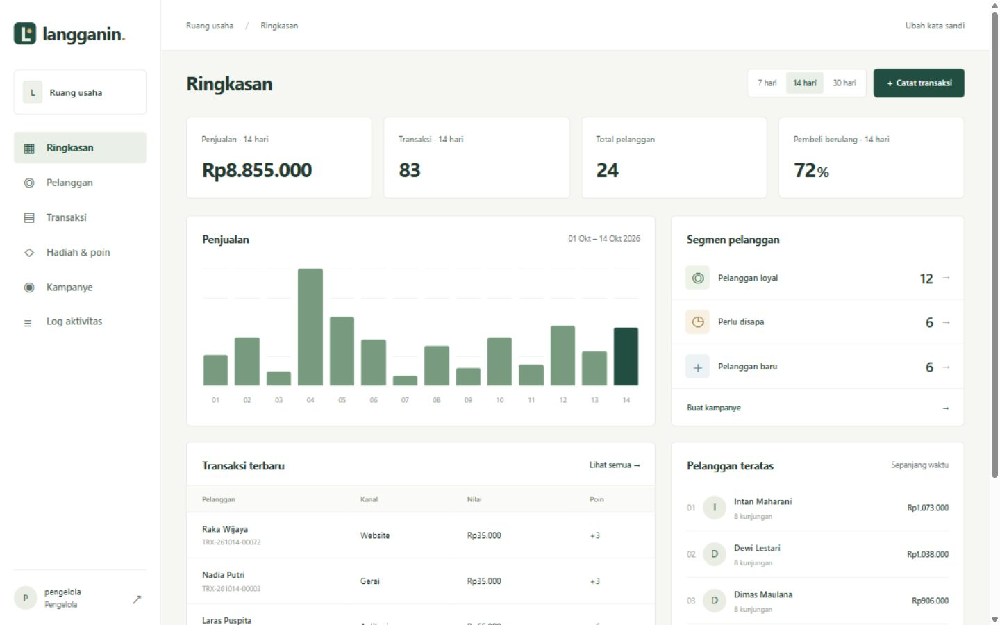

# Langganin

CRM & loyalty untuk usaha dengan pelanggan berulang. Portofolio mandiri untuk menunjukkan kemampuan Python/Django, PostgreSQL, transaksi database, dan keamanan aplikasi. Terinspirasi kategori produk publik Stamps, tidak berafiliasi dan tidak memakai kode, aset merek, atau data pelanggan Stamps.

## Fitur yang berjalan

- Dashboard penjualan dengan pilihan 7, 14, dan 30 hari, persentase pembeli berulang, pelanggan teratas, dan segmentasi berbasis aturan.
- Profil pelanggan, pencarian, normalisasi nomor Indonesia, persetujuan kampanye yang dapat dicabut pengelola.
- Pencatatan nilai transaksi dari gerai, website, atau aplikasi secara **manual**, bukan integrasi POS sungguhan.
- Satu poin per Rp10.000, buku besar poin, hadiah dengan stok, dan penukaran atomik.
- Nomor struk unik dan kunci permintaan mencegah penambahan poin dua kali ketika formulir dikirim ulang.
- Kampanye segmen dengan penerima yang menyetujui pemasaran. Hasilnya notifikasi internal di profil pelanggan, **bukan pengiriman WhatsApp, SMS, email, atau portal pelanggan publik**.
- Peran pengelola dan kasir, audit log, pergantian kata sandi, dan pembatasan percobaan masuk melalui Redis.
- Demo sintetis terpisah yang menolak pengisian pada database usaha yang sudah berisi data.

Stack: Django 5.2 LTS, PostgreSQL, Redis, template Django, CSS lokal, WhiteNoise, Waitress. Tidak membutuhkan JavaScript build atau layanan berbayar.

Antarmuka ditujukan untuk pengguna usaha: tanpa banner demo, slogan tambahan pada setiap halaman, atau catatan developer. Data portofolio tetap **sintetis**, bukan bukti pelanggan atau penjualan nyata. Nomor telepon disamarkan pada daftar dan profil; alamat email contoh memakai domain `example.com`. Dokumentasi ini tetap menjelaskan asal data untuk peninjau.



## Jalankan di Windows

Prasyarat: Git, uv, dan PostgreSQL lokal dengan direktori `bin` yang berisi `initdb.exe`, `pg_ctl.exe`, `psql.exe`, serta `createdb.exe`.

Clone repo, masuk ke direktori proyek, lalu arahkan `LANGGANIN_PG_BIN` ke instalasi PostgreSQL Anda. Ganti contoh lokasi berikut sesuai mesin:

```powershell
git clone https://github.com/ramaikn/langganin.git
cd langganin
$env:LANGGANIN_PG_BIN = 'C:\Program Files\PostgreSQL\17\bin'
powershell -NoProfile -ExecutionPolicy Bypass -File scripts/dev.ps1 -Demo
```

Buka **http://127.0.0.1:8017**. Akun: `pengelola` dan `kasir`.

Kata sandi acak dibuat otomatis dan disimpan di:

```text
%LOCALAPPDATA%\Temp\opencode\langganin\local-secrets.json
```

`manager` adalah kata sandi pengelola, `cashier` untuk kasir. File ini dibatasi ke akun Windows pemilik. Jangan unggah atau bagikan isinya. Tidak ada kata sandi bawaan dalam kode.

- Tanpa `-Demo`: database baru dimulai kosong. Menghilangkan flag tidak menghapus demo yang sudah dibuat.
- `uv run manage.py refine_demo`: merapikan referensi struk dan kronologi record contoh lama. Tidak menghapus data, menggandakan transaksi, atau mengubah saldo. Hanya dapat dijalankan pada database bertanda demo.
- `-NoServer`: hanya menyiapkan layanan, migrasi, akun, dan opsional demo.
- Dependensi Python memakai cache uv dan hardlink di C:. PostgreSQL serta Redis khusus Langganin berjalan pada loopback port 5547 dan 6397, bukan layanan Windows.
- Skrip lama memiliki fallback binari portabel workspace `../../.tools/pgsql/bin`. Pada checkout mandiri, isi `LANGGANIN_PG_BIN` dengan lokasi bin PostgreSQL; variabel ini juga dipakai oleh skrip penghentian layanan.
- Redis lokal menggunakan port komunitas Windows 8.10.2 dengan checksum SHA-256 yang diverifikasi. Bukan distribusi Windows resmi Redis; production disarankan Linux/container.
- Runtime Windows tersimpan di `%LOCALAPPDATA%\Temp\opencode\langganin`, terpisah dari source. Folder Temp dapat dibersihkan sistem, sehingga **bukan tempat menyimpan data usaha sungguhan tanpa backup**.
- `ExecutionPolicy Bypass` hanya berlaku untuk proses perintah ini, tidak mengubah kebijakan Windows permanen.

Hentikan server dengan Ctrl+C. Hentikan layanan khusus Langganin:

```powershell
powershell -NoProfile -ExecutionPolicy Bypass -File scripts/stop.ps1
```

## Pengujian

Setelah layanan lokal berjalan:

```powershell
powershell -NoProfile -ExecutionPolicy Bypass -File scripts/test.ps1
```

Database `test_langganin` dibuat terpisah dan dihapus setelah pengujian. Redis database 1 dipakai khusus pengujian, database 0 untuk aplikasi. Akun database lokal adalah pemilik cluster khusus demo untuk memudahkan setup dan pengujian, bukan contoh hak akses minimum production.

Laporan faktual ada di [docs/verification.md](docs/verification.md). Peta kode dan aturan bisnis: [docs/architecture.md](docs/architecture.md).

## Cara menjalankan umum dengan uv

```powershell
uv sync --frozen --link-mode hardlink
Copy-Item .env.example .env
# Isi .env, aktifkan DJANGO_DEBUG=1 hanya untuk localhost.
uv run manage.py migrate
$env:LANGGANIN_MANAGER_PASSWORD = '<kata-sandi-acak-minimal-12-karakter>'
$env:LANGGANIN_CASHIER_PASSWORD = '<kata-sandi-acak-berbeda-minimal-12-karakter>'
uv run manage.py setup_roles
uv run manage.py seed_demo
uv run manage.py runserver 127.0.0.1:8017
```

`DATABASE_URL` kosong memakai SQLite untuk percobaan satu pengguna. PostgreSQL diperlukan untuk bukti penguncian baris saat akses bersamaan. Redis opsional hanya pada mode lokal; production gagal mulai jika Redis atau secret belum dikonfigurasi.

## Deployment

Konfigurasi Docker tersedia, tetapi belum dijalankan di lingkungan ini karena Docker tidak terpasang. Ikuti [docs/deployment.md](docs/deployment.md), termasuk reverse proxy HTTPS. Tidak cukup menjalankan `docker compose up` lalu membuka HTTP, karena mode production sengaja memaksa HTTPS.

## Bahan presentasi 5 menit

1. Tunjukkan dashboard dan jelaskan semua data adalah sintetis.
2. Pilih pelanggan, catat pembelian Rp50.000, lihat saldo bertambah 5 poin.
3. Tukarkan hadiah dan tunjukkan stok, saldo, serta buku besar berubah bersama.
4. Buat kampanye lalu terbitkan; buka profil penerima untuk melihat notifikasinya.
5. Masuk sebagai kasir dan tunjukkan bahwa kampanye serta log aktivitas ditolak.
6. Jelaskan pengujian paralel, batas fitur, dan bagian yang ingin dikembangkan.

Untuk CV, deskripsi yang dapat dibuktikan: “Mengembangkan Langganin, CRM dan loyalty berbasis Django/PostgreSQL dengan transaksi poin atomik, segmentasi pelanggan, kampanye internal berbasis persetujuan, serta pengujian transaksi bersamaan.” Jangan mengklaim pelanggan produksi, kenaikan pendapatan, integrasi WhatsApp, native mobile, sertifikasi keamanan, atau skala jutaan pengguna.

Riset lowongan dan produk: [docs/research.md](docs/research.md). Repo publik: [ramaikn/langganin](https://github.com/ramaikn/langganin). Publikasi kode tidak mencakup deployment aplikasi, perubahan CV, atau pengiriman lamaran.
